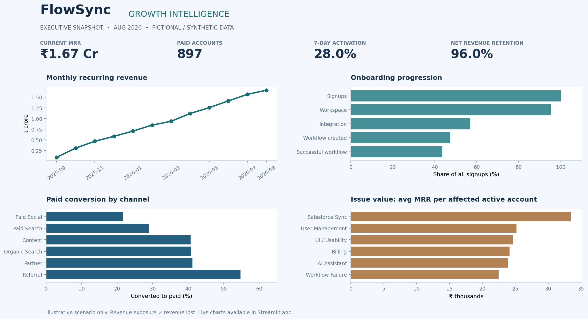

# FlowSync — SaaS Growth Intelligence

**A practical, business-first Product Analytics + AI Voice-of-Customer portfolio project.**  
*Reproducible synthetic scenario · Snapshot: 31 August 2026 · No real company data or claimed commercial impact.*



### The business problem

FlowSync (fictional B2B SaaS) converts some free-trial accounts into paying customers but lacks a joined-up view of product onboarding, recurring revenue, acquisition quality and customer pain points. This project helps Product, Growth and Customer Success decide where to investigate next. The optional AI feature structures unstructured support tickets for **human review**—it does not automate consequential decisions.

### What is actually built

- **Nine linked synthetic data tables:** 3,000 accounts, 14,963 users, 289,792 product events, 4,790 tickets and 2,417 feedback records, spanning September 2025–August 2026.
- **Business-question SQL:** ordered onboarding funnel, 7-day activation, paid conversion by channel, snapshot MRR, team adoption and revenue-exposed support issues.
- **Python reporting layer:** reconciled MRR/ARR, revenue movements, NRR/GRR, retention cohorts, descriptive health score, AI feature usage/cost and simulated experiment uncertainty.
- **Three-section interactive dashboard:** executive overview; product growth/experiment; customer and AI insights.
- **Optional real LLM integration:** enter **your own key** in the dashboard to classify synthetic ticket text into structured themes and tentative root-cause hypotheses. The existing charts use supplied labels, not pre-run AI outputs.
- **Recruiter-readable case study, documentation, tests and static preview.**

### Verified synthetic scenario highlights

| KPI / finding | Value |
|---|---:|
| Current MRR / annualized run rate | ₹1.67 Cr / ₹19.98 Cr |
| Active paid accounts | 897 |
| 7-day account activation | 28.0% |
| Referral vs Paid Social paid conversion | 54.7% vs 21.5% |
| Latest NRR | 96.0% |
| Simulated integration-first test | +13.3 percentage points observed, synthetic only |

**Important:** These are computed from deliberately simulated data; they are not commercial achievements. Read [the complete case study](docs/CASE_STUDY.md) before using the numbers in a resume or interview.

### Run the dashboard

```bash
# Python 3.10+ in the project folder
python -m venv .venv
# Activate your venv (Windows: .venv\Scripts\activate; macOS/Linux: source .venv/bin/activate)
pip install -r requirements.txt
streamlit run app.py
```

A free/open dashboard mode works with **no API key**. For the live LLM Voice-of-Customer panel, paste a key into the in-app password input (or set `OPENAI_API_KEY` locally). Never commit API keys. Only use synthetic/anonymized ticket samples in the demo.

### Reproduce the analysis or test it

```bash
python scripts/generate_dataset.py   # optional: overwrites only data/raw with seed=42
python analytics/build_marts.py       # writes data/processed
python -m pytest -q                  # validation checks
```

The already-generated `data/raw` and `data/processed` are intentionally committed, so reviewers can open the dashboard immediately without running the generator.

### Repository map

```text
app.py                    Interactive dashboard (3 tabs)
ai_voc.py                 Optional structured LLM + human-review rule
analytics/build_marts.py  Reproducible account/revenue/customer marts
scripts/                  Reproducible synthetic dataset generator
sql/                      PostgreSQL schema, core queries and import guide
data/raw/                 Synthetic source CSVs and generator notes
data/processed/           Tested dashboard-ready reporting outputs
docs/CASE_STUDY.md        Verified results, decisions and caveats
docs/AI_EVALUATION.md     Workflow, evaluation design, risks and limits
docs/DEPLOYMENT.md        Optional Streamlit deployment guide
assets/                   Dashboard screenshot
```

### Honest skill coverage

**Demonstrated:** business problem framing, SaaS KPIs, SQL analysis, basic Python data processing, funnel/cohort and subscription analytics, A/B-test interpretation, product recommendations, LLM workflow design and structured-output safeguards.

**Not claimed:** live production SaaS integration, measured LLM accuracy, real revenue/ROI outcomes, advanced churn ML, or production-grade ML/AI infrastructure.

### Source documentation

[Product brief](docs/PRODUCT_BRIEF.md) · [Case study](docs/CASE_STUDY.md) · [Data schema](docs/DATA_MODEL.md) · [SQL guide](docs/SQL_GUIDE.md) · [AI evaluation](docs/AI_EVALUATION.md) · [Deployment](docs/DEPLOYMENT.md)

**License:** MIT. **Scope:** early-career business/product/analytics portfolio, not a production service.
